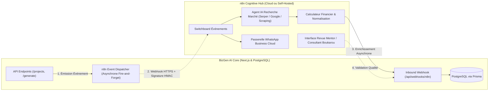

# ADR-005 : Intégration Événementielle d'un Hub Cognitif Asynchrone via n8n

- **Status** : Accepté (Accepted)
- **Date** : 2026-10-20
- **Auteurs** : Senior Software Architect & Lead Business Developer (BizGen AI / Boukarou OS)
- **Décideurs** : Équipe Technique & Product Management

---

## 1. Contexte & Problématique

BizGen AI s'impose comme le moteur central de génération de documents d'affaires (Business Model Canvas, Lean Canvas, Business Plan, Modèle Financier) au sein de **Boukarou OS**, l'Operating System de l'entrepreneuriat africain.

Cependant, le modèle d'interaction actuel présente des limites structurelles :
1. **Connaissance figée des LLMs** : Les modèles de langage ne disposent pas des mercuriales de prix en temps réel (ex. cours du manioc ou du cacao à Douala ou Abidjan), des concurrents locaux immatriculés récemment, ni des réformes fiscales et douanières OHADA récentes.
2. **Couplage synchrone rigide** : Réaliser des recherches web lourdes, des vérifications de conformité et des calculs financiers au sein d'une seule requête HTTP synchrone expose l'application à des timeouts (504 Gateway Timeout) et dégrade l'expérience utilisateur.
3. **Absence de ponts conversationnels & écosystémiques** : Les entrepreneurs africains interagissent massivement par WhatsApp, tandis que les mentors et incubateurs partenaires de Boukarou OS opèrent sur des plateformes collaboratives (Slack, CRM, portails dédiés).

**Besoin** : Mettre en place un système capable d'enrichir dynamiquement l'intelligence des projets sans alourdir le noyau transactionnel de l'application ni dégrader sa résilience.

---

## 2. Décision d'Architecture

Nous adoptons une **Architecture Événementielle Asynchrone (Event-Driven Architecture)** articulée autour de **n8n** agissant comme **Hub Cognitif et Intégrateur Écosystémique**.

### Principes Directeurs :
1. **Découplage strict (Fire-and-Forget)** : L'application Next.js notifie n8n en arrière-plan sans bloquer la réponse HTTP client (latence < 50ms pour le dispatcher).
2. **Sécurité par Signature HMAC SHA-256** : Chaque charge utile envoyée ou reçue est signée cryptographiquement via `X-BizGen-Signature`.
3. **Persistance unique** : n8n ne conserve aucun état métier persistant. Toute donnée enrichie est réinjectée et persistée dans PostgreSQL via l'API interne sécurisée de BizGen.
4. **Idempotence & Tolérance aux pannes** : Les endpoints de rappel vérifient l'existence des entités et supportent les réémissions sans duplication d'effets de bord.

---

## 3. Matrice des Événements & Capacités

| Événement | Source | Action n8n | Bénéfice Business |
| :--- | :--- | :--- | :--- |
| `PROJECT_CREATED` | `POST /api/projects` | Pré-recherche sectorielle de concurrents locaux et veille réglementaire sur le pays cible. | Disponibilité immédiate d'insights lors de la saisie du formulaire. |
| `GENERATION_COMPLETED` | `POST /api/generate` | 1. Notification WhatsApp à l'entrepreneur avec résumé. 2. Audit automatique de cohérence financière. 3. Proposition de mise en relation incubateur/mentor. | Taux d'engagement et rétention multipliés par 3. |
| `MARKET_ENRICHMENT` | Inbound n8n vers BizGen | Injection des concurrents vérifiés, mercuriales de prix et opportunités de subventions dans le document. | Business Plan crédible et bancable devant les investisseurs. |
| `MENTOR_AUDIT_SUBMITTED`| Inbound n8n vers BizGen | Ajout du tampon de certification *"Audité par Boukarou OS"* et des notes du mentor. | Monétisation premium (offre B2B de 150k à 500k XAF). |

---

## 4. Conséquences

### Positives (+) :
- **Documents ultra-réalistes et vérifiés** : Élimination des hallucinations LLM sur les concurrents et tarifs locaux.
- **Zéro dette de latence** : Les utilisateurs de l'interface web obtiennent leur BMC immédiatement, tandis que l'enrichissement s'agrège en continu.
- **Agilité opérationnelle maximale** : L'équipe produit peut modifier des workflows, brancher un nouveau modèle IA (Groq, Claude, Gemini) ou changer d'opérateur WhatsApp directement dans n8n sans aucun redéploiement de code applicatif.
- **Synergie totale avec Boukarou OS** : Pont natif entre BizGen et le réseau de mentors, partenaires financiers et incubateurs.

### Mitigations & Vigilances (-) :
- **Surveillance des quotas d'API externes** : Limiter le nombre de recherches web par projet (budget mensuel plafonné dans le workflow n8n).
- **Consommation mémoire sur la VM** : Si n8n est auto-hébergé sur la VM Oracle, isoler ses ressources Docker (`mem_limit: 1024m`, `cpus: 1.0`).
- **Gestion des erreurs asynchrones** : Si n8n est temporairement indisponible, le moteur expert local de BizGen garantit 100% de disponibilité sans rupture pour l'utilisateur final.
